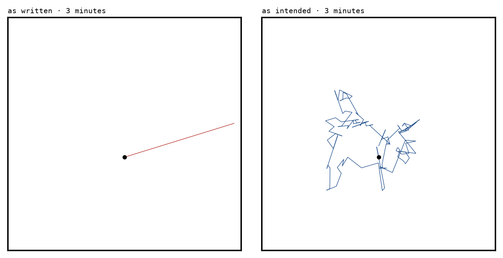

# E-Bhapa

**Six hours, no team, one ultrasonic sensor. What did the robot actually do?**

February 2024, a university robotics contest. The team bailed, the last servo
burnt out, and the components cupboard was empty. What was left: a 4WD chassis
on an Adafruit motor shield, an HC-SR04 ultrasonic sensor, about four coffees
and a night.

The original README promised a lot: object following, dynamic obstacle
avoidance with randomised turns, enhanced exploration, proportional and
adaptive speed control. It was written at hour five. This repo checks it
against the code.

## The audit

`e_bhapa/e_bhapa.ino` is the contest sketch, unchanged. Read closely, it has
opinions the README didn't mention:

| the README said | the code does | why |
|---|---|---|
| backs up, turns in place | **never reverses, never turns** | `adjustMotorSpeed(left, right)` sends `left` to motors 1 *and* 2 (front-left, front-right) and `right` to 3 and 4 (the rear pair). Each side of a skid-steer chassis then averages the two, so both sides always match. |
| "move backward" | moves forward, slowly | AFMotor's `setSpeed()` takes a `uint8_t`. −255 wraps to **1**, −200 to **56**, −150 to **106**. Every `run()` call says `FORWARD` anyway. |
| follows objects at a safe distance | **drives into them, gently** | Within 25 cm, speed maps 0→25 cm onto PWM 100→255. Closer means slower, but never stopped. |
| dynamic obstacle avoidance | fires in a 5 cm band | Avoidance runs only between 25 and 30 cm. Anything nearer is "followed". |
| enhanced exploration, 5 behaviours | 5 behaviours, half the time | `random(0, 10)` picks a case, and only cases 0–4 exist. |

## The re-enactment

`sim/run.py` runs the sketch line for line in a 3 × 3 m room, with the same
thresholds, random draws and `delay()`s, and both hardware quirks. A second
run fixes only the wiring and the signs and leaves the logic alone.



| ten runs × 3 min | pinned against a wall | room visited |
|---|---:|---:|
| **as written** | **92 %** of the time, first after a median 14 s | 3 % |
| as intended | 25 % | 9 % |

As written, E-Bhapa picks a direction, drives to the nearest wall at a
respectful decelerating crawl, and stays there pressing gently for the rest of
the demo. That is, technically, following an object.

Fixed, it wanders. It still parks against a wall a quarter of the time,
because "follow anything within 25 cm" can't tell a person from a wall. One
sensor pointing forward can't either. That was the real lesson, and it took
a later robot with more than one sensor to learn it properly.

## Run it

```bash
python -m venv .venv && . .venv/bin/activate
pip install -r requirements.txt
python -m sim.run            # ~2 s, prints the table, rewrites assets/*.png
```

The sketch builds in the Arduino IDE with the **Adafruit Motor Shield library
(v1, `AFMotor.h`)** from the Library Manager. The 2024 commit had a copy of
every Adafruit library on the laptop that night; they've been removed in
favour of the Library Manager.

Six hours, no sleep, wrong wires. It shipped.
