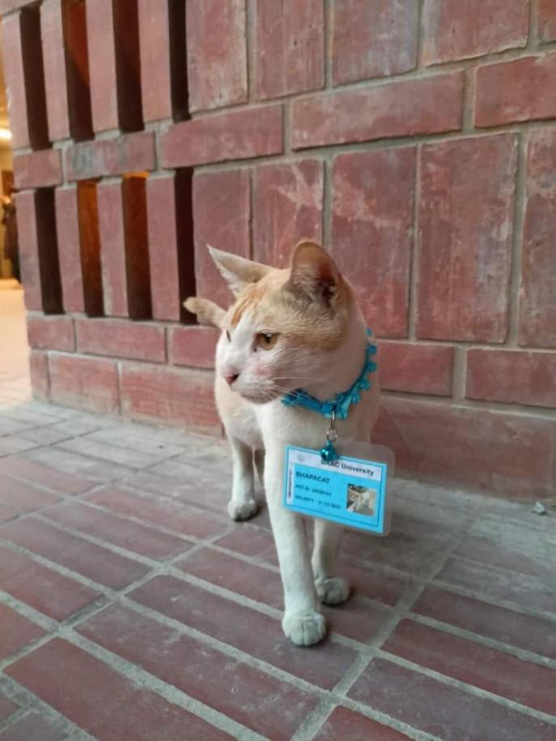
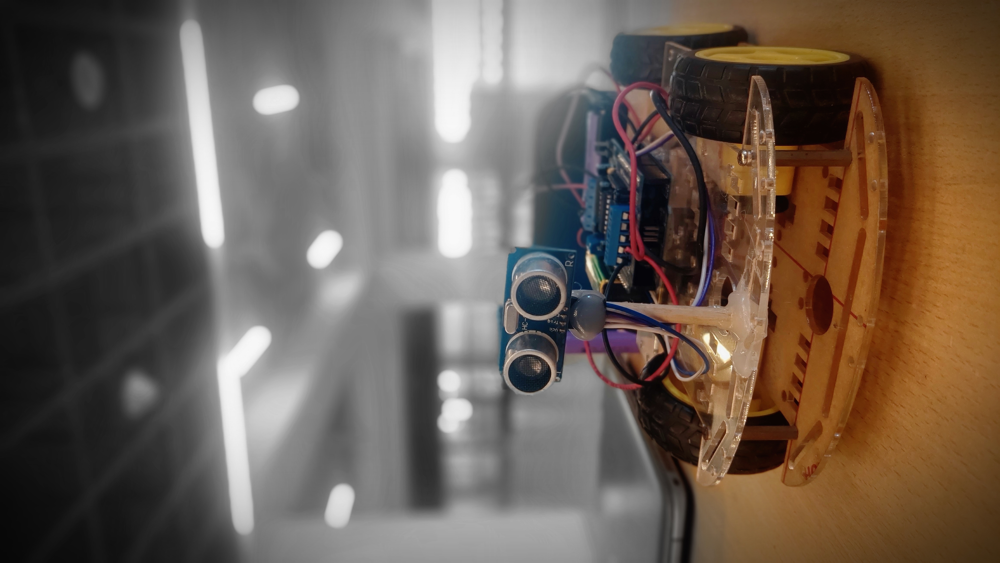

# E-Bhapa

Bhapa                      |  E-Bhapa
:-------------------------:|:-------------------------:
   |  

*Looks identical, wow.*

**Six hours, no team, one ultrasonic sensor, and a campus cat for a role model.**

February 2024, a university robotics contest. The team bailed, the last servo
burnt out and the components cupboard was empty. What was left: a 4WD acrylic
chassis, an Arduino Uno with an L293D motor shield, an HC-SR04 ultrasonic sensor
on a stalk, about four coffees and one night. The robot was named after
**Bhapa**, the campus cat, who has her own university ID and much better
obstacle avoidance.

The 2024 README (kept, lovingly, in [`README-2024.md`](README-2024.md)) promised
intelligent object following, dynamic obstacle avoidance, enhanced exploration,
and proportional *and* adaptive speed control. It was written at hour five.
Two years later I read the code properly, found out what the robot had
actually been doing, and fixed it.

## What v1 really did

| the 2024 README said | the code actually did | why |
|---|---|---|
| turns, backs up | **never turned, never reversed** | `adjustMotorSpeed(left, right)` sent `left` to motors 1 *and* 2, front-left and front-right, and `right` to the rear pair. Each side then averages front and rear, so both sides always match. |
| "move backward" | moved forward, slowly | AFMotor's `setSpeed()` takes a `uint8_t`. −255 becomes **1**, −200 becomes **56**. And every `run()` said `FORWARD` anyway. |
| follows objects at a safe distance | **drove into them, politely** | Within 25 cm, closer meant slower, but never stopped. |
| dynamic obstacle avoidance | in a 5 cm band | Avoidance only ran between 25 and 30 cm. Anything nearer got "followed". |
| five exploration behaviours | five, half the time | `random(0, 10)` with cases 0–4 only. |
| — | froze for up to a second | `pulseIn()` with no timeout waits a full second for an echo that isn't coming. |

## v2: the fix

[`e_bhapa_v2/e_bhapa_v2.ino`](e_bhapa_v2/e_bhapa_v2.ino) runs on the same robot
with the same single sensor. It compiles for an Uno at 5,030 bytes.

1. **Wiring:** left = motors 1 + 3, right = 2 + 4.
2. **Signs:** `setSpeed(|pwm|)`, `run(FORWARD | BACKWARD)` from the sign.
3. **Sonar:** a 25 ms timeout (~4 m). No echo means "nothing there", not "freeze".
4. **Following holds a distance instead of closing it.** Proportional on the
   error to 30 cm with a ±4 cm dead band: approach when far, back off when near.
5. **Walls are boring.** A single forward ray can't tell a cat from a wall,
   but *time* can: a wall's distance never changes. If the reading stays
   within 3 cm for 2.5 s it's furniture, so turn away and find something
   that moves.
6. **Exploration** picks from behaviours that exist.

## Three robots, one room, one cat

[`sim/run.py`](sim/run.py) runs the sketches line for line in a 3 × 3 m room:
same thresholds, same random draws, same `delay()`s, and v1's hardware quirks
on. A simulated Bhapa wanders at 0.15 m/s and stops whenever she feels like it.


| ten runs × 3 min | pinned against something | room visited | time near the cat |
|---|---:|---:|---:|
| v1, as flashed in 2024 | 87 % | 6 % | 7 % |
| v1, wiring fixed | 69 % | 4 % | 5 % |
| **v2** | **1 %** | **23 %** | **14 %** |

Rewiring alone doesn't save v1. It turns now, but the "follow" rule still
drives it into the first wall it meets. Wiring was the bug. The *rule* was
the design mistake.

## Lessons, paid for in one night

- **Read the library's types.** A `uint8_t` parameter turns a negative speed
  into a polite crawl, and the compiler doesn't argue.
- **Label your wires the same way your code names them.** "Left" in a comment
  is not left in copper.
- **A sensor reading is a number. Behaviour needs a rule about *change*.**
  One ultrasonic ray will never tell a cat from a wall. A few seconds of
  memory will.
- **Never block on a sensor without a timeout.** The world is allowed not to
  answer.

## Run it

```bash
python -m venv .venv && . .venv/bin/activate
pip install -r requirements.txt
python -m sim.run                    # ~6 s, prints the table, rewrites assets/three_minutes.png

arduino-cli lib install "Adafruit Motor Shield library"
arduino-cli compile -b arduino:avr:uno e_bhapa_v2     # or open it in the Arduino IDE
```

## Layout

```
e_bhapa/e_bhapa.ino         the 2024 contest sketch, untouched
e_bhapa_v2/e_bhapa_v2.ino   the same robot, fixed
sim/run.py                  both sketches, re-enacted with a cat
README-2024.md              the original README, written at hour five
assets/original/            the two photos that started it all
```

The 2024 commit also had a copy of every Adafruit library on that laptop;
they're gone in favour of the Library Manager.
